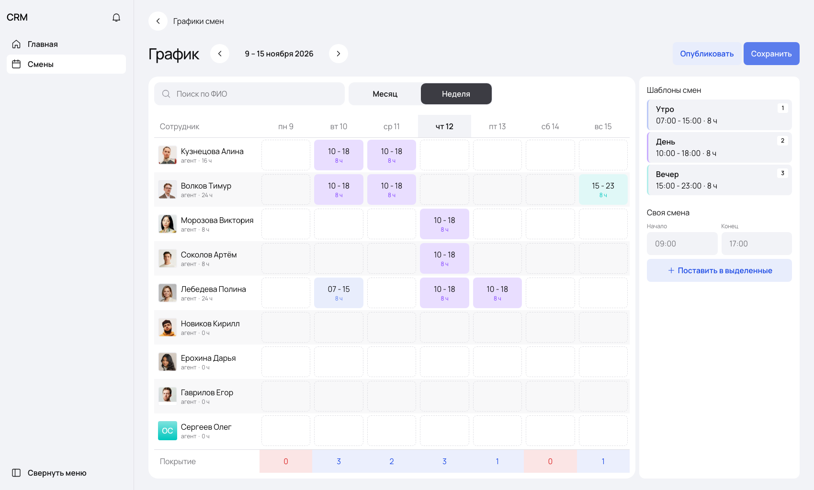
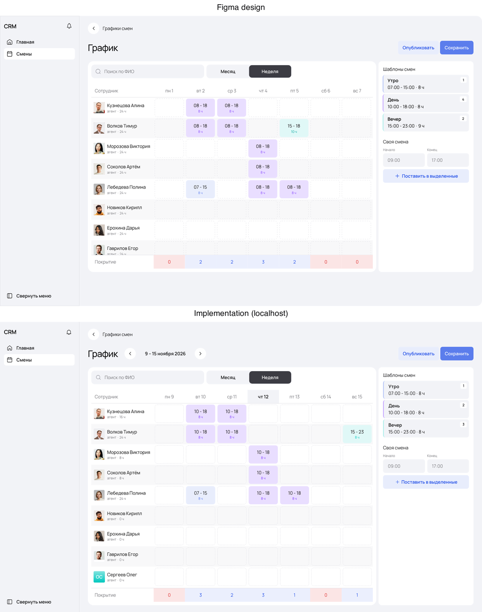

# График смен — тестовое задание Fullstack

Интерфейс планирования графика смен сотрудников по макету из Figma: календарь (неделя / месяц), поиск, шаблоны смен, своя смена, массовое выделение, drag-and-drop, динамическое покрытие, сохранение и публикация.



**Демо:** http://shifts.178-105-166-92.sslip.io

---

## Стек

Взят из вакансии (в файле задания указан Vue 3 + Laravel, но мне написали, что стек — как на hh):

| Слой | Технологии |
|---|---|
| Frontend | **Next.js 15** (App Router, static export), **React 19**, TypeScript, Tailwind CSS, TanStack Query, Zustand, dnd-kit |
| Backend | **Bun + Hono**, Zod-валидация, **Drizzle ORM** + миграции |
| БД | **PostgreSQL** |
| Общий код | `packages/shared` — контракты API (Zod-схемы → типы) и доменная логика, общие для фронта и бэка |
| Тесты | `bun test` (юнит + интеграционные API-тесты на реальном Postgres), **Playwright** (e2e) |
| Инфра | Dockerfile (multi-stage), docker-compose, GitHub Actions CI |

## Соответствие макету

Значения взяты из Figma напрямую (Copy as code → CSS всех слоёв + экспорт SVG), а не на глаз: шрифт **Manrope**, цвета, отступы, радиусы, размеры ячеек (110×72 / 64×72), цвета шаблонов, состояния кнопок (default / hover / active / disable), фоны покрытия. Затем каждый экран сверялся с макетом скриншотом 1700×1024 и попиксельным diff.



Экспорт всех экранов макета лежит в [`docs/design/`](docs/design).

## Что реализовано (по пунктам ТЗ)

**График смен**
- Календарь со списком сотрудников и сменами, переключатель **Месяц / Неделя**.
- **Поиск по ФИО** (на сервере, без учёта регистра, «е» = «ё»: «артем» находит «Артём»).
- **Навигация по датам**: стрелки ← период →; вид и дата хранятся в URL (`?view=month&date=2026-11-01`), ссылкой можно поделиться.
- У сотрудника под именем считаются часы за видимый период; в месячном виде таблица прокручивается к сегодняшнему дню.

**Назначение смены**
1. **Клик по дате** в шапке выделяет весь день, появляется панель быстрых действий → «Применить шаблон».
2. **Клик по ячейке** (или протягивание мышью прямоугольником, Ctrl/⌘ — добавить, Shift — диапазон) выделяет ячейки, после чего можно выбрать шаблон.

Смена сразу появляется в календаре; все способы работают с одним и тем же состоянием, смену можно изменить или удалить.

**Шаблоны («Утро», «День», «Вечер»)**: клик по карточке назначает шаблон выделенным ячейкам, бейдж на карточке — горячая клавиша (**1 / 2 / 3**). Шаблоны переиспользуются для любых сотрудников.

**Своя смена**: выделяешь ячейки, вводишь начало и конец («10», «930», «09:30» нормализуются), жмёшь «Поставить в выделенные». «Изменить» в панели выделения подставляет время существующей смены для правки. Поддерживаются ночные смены (22:00–06:00 = 8 ч).

**Покрытие**: строка внизу считает сотрудников со сменой на каждую дату. Значение 0 подсвечивается красным, >0 голубым. Это чистая функция от текущего состояния, поэтому пересчёт мгновенный и без запросов.

**Drag-and-drop**
- шаблон из панели → в ячейку (если ячейка выделена — во всё выделение);
- смена → в другую ячейку (перенос; с Alt/Option — копирование).

**Сохранение / публикация**
- Правки копятся локально как черновик. «Сохранить» отправляет минимальный diff одним запросом, и он применяется **в одной транзакции**. Счётчик несохранённых изменений висит на кнопке, при уходе со страницы с несохранённым показывается предупреждение.
- «Опубликовать» сохраняет черновик и переводит смены периода из `draft` в `published`; любая последующая правка возвращает смену в `draft`.
- **Ctrl/⌘+Z** отменяет последнее действие, **Delete** очищает выделенное, **Esc** снимает выделение, **Ctrl/⌘+S** сохраняет.

## Архитектура

```
apps/
  api/      Hono-сервер: REST API + раздача собранного фронта в проде
  web/      Next.js (static export) — страница графика
packages/
  shared/   Zod-схемы (контракт API), даты/время, покрытие, diff черновика
```

**Поток данных на фронте.** Серверные данные лежат в кэше TanStack Query, правки — в Zustand как оверлей `Map<"employeeId|date", Shift | null>` (`null` означает «очищено»). То, что видит пользователь, — `applyDraft(server, draft)`; покрытие, часы и счётчики выводятся из этого же состояния. При сохранении `diffDraft` отбрасывает правки, вернувшиеся к серверному значению, и отправляет только реальные изменения. Логика покрыта юнит-тестами в `packages/shared`.

**Все команды редактора** (панель, горячие клавиши, DnD, карточки шаблонов) проходят через один модуль `lib/actions.ts`, поэтому способы назначения ведут себя одинаково.

### БД

| Таблица | Ключевое |
|---|---|
| `employees` | `search_name` — нормализованное ФИО для поиска (не зависит от `LC_CTYPE` базы: ILIKE по кириллице ломается под локалью `C`) |
| `shift_templates` | время начала/конца, цвет, горячая клавиша (unique) |
| `shifts` | `UNIQUE (employee_id, date)` — одна смена на ячейку; индекс по `date` для выборки периода; `CHECK start <> end`; `template_id ON DELETE SET NULL` (смена остаётся как «своя»); статус `draft/published` |

### API

| Метод | Путь | Описание |
|---|---|---|
| GET | `/api/employees?q=` | список / поиск сотрудников |
| GET | `/api/templates` | шаблоны смен |
| GET | `/api/shifts?from&to` | смены за период (не больше 62 дней) |
| PUT | `/api/shifts` | `{ upserts[], deletes[] }` — пакет изменений в одной транзакции |
| POST | `/api/schedule/publish` | `{ from, to }` — публикация периода |

Ошибки приходят в едином формате `{ error: { code, message, details? } }`: 400 — валидация (Zod, сообщения на русском), 422 — несуществующий сотрудник или шаблон (ничего не записывается).

## Запуск

### Docker (проще всего)

```bash
docker compose up --build
```

Откроется http://localhost:3000. Миграции и демо-данные применяются при старте.

### Локально

Нужны Bun ≥ 1.3 и PostgreSQL.

```bash
bun install
cp .env.example apps/api/.env      # поправьте DATABASE_URL
bun run db:migrate && bun run db:seed
bun run dev:api                     # API на :3001
bun run dev:web                     # фронт на :3000 (NEXT_PUBLIC_API_URL=http://localhost:3001)
```

### Тесты

```bash
TEST_DATABASE_URL=postgres://…/shifts_test bun run test   # 22 юнит- и API-теста (тестовая БД очищается!)
bun run --cwd apps/web test:e2e                            # Playwright, против запущенного стека
bun run typecheck
```

Всё это же выполняется в CI ([`.github/workflows/ci.yml`](.github/workflows/ci.yml)): typecheck → тесты на Postgres → сборка → прод-сервер → e2e.

### Продакшен без Docker (например, alwaysdata)

```bash
bun run build                                    # apps/web/out
cd apps/api && STATIC_DIR=../web/out MIGRATE_ON_START=1 SEED_ON_START=1 bun src/index.ts
# хостинг только с Node.js: тот же сервер через адаптер @hono/node-server
cd apps/api && STATIC_DIR=../web/out npx tsx src/node.ts
```

## Решения и отступления от макета

- **Навигация по датам.** В ТЗ она есть, в макете нет. Добавил стрелки и подпись периода рядом с заголовком, в стилях макета (круглые кнопки как «назад»).
- **Бейджи 1/2/3 на шаблонах.** В компоненте они называются `KeyButton`, на пустом графике показывают 1, 2, 3, поэтому реализовал их как горячие клавиши.
- **Часы считаются из времени.** В макете у «Вечер 15:00–23:00» стоит «9 ч», а у «15–18» — «10 ч»; это данные-заглушки. В реализации часы вычисляются (15:00–23:00 = 8 ч).
- **Высота карточки.** В макете фрейм фиксированной высоты 740px. В реализации карточка тянется на всю высоту окна, список прокручивается, шапка и строка покрытия закреплены.
- **Склонения.** «2 ячейки», «1 сотрудник» вместо «2 ячеек», «сотрудника(-ов)».
- **Адаптив.** На узких экранах сайдбар скрыт, панель шаблонов уходит под календарь, колонка сотрудника сужается до 150px, таблица прокручивается по горизонтали.
- Девятый сотрудник без фото показывает fallback-аватар с инициалами из дизайн-системы («Ячейка сотрудника»).
